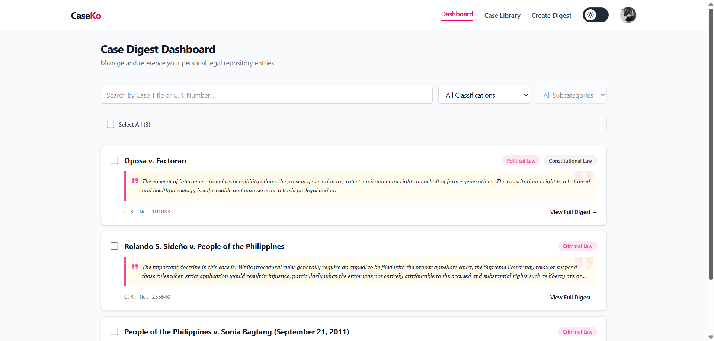
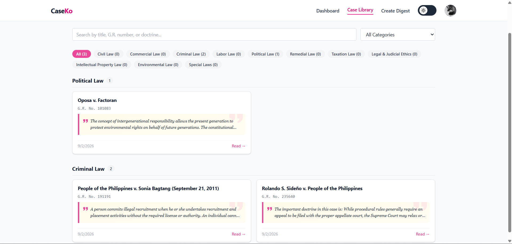
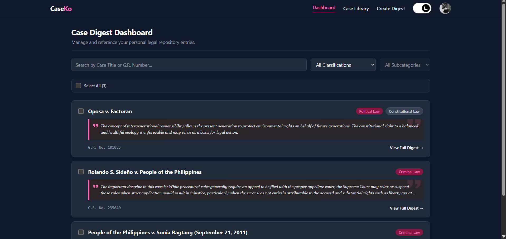

# CaseKo

A modern, full-stack personal case digest repository for Philippine jurisprudence — built to organize, search, and review case law for law students, legal practitioners, and Philippine Bar reviewees.

**[Live Demo](https://case-digest-repo-pied.vercel.app)** · Built with Next.js (App Router), Supabase (Postgres & Auth), and Tailwind CSS v4

---

## Why CaseKo?

Reviewing Philippine jurisprudence requires tracking hundreds of Supreme Court decisions across all Bar exam subjects — their facts, legal issues, doctrines, and rulings — in a format that is immediately searchable, structurally categorized, and rapid to review.

Existing generic note-taking tools lack legal taxonomy, citation linking, and citation-specific search. **CaseKo** is purpose-built for Philippine legal review:

- **Philippine Bar Syllabus Alignment**: Pre-configured with the 8 official Bar examination subjects and extensive subcategories (e.g., CPRA in Legal Ethics, Kalikasan in Remedial Law, FRIA & AMLA in Commercial Law).
- **PostgreSQL Full-Text Search (FTS)**: High-performance weighted searching across case titles, G.R. numbers, key doctrines, facts, and rulings powered by GIN indexes.
- **Direct Primary Source Verification**: 1-click links to official decisions on **Lawphil**, the **Supreme Court E-Library**, and the **ChanRobles Law Library**.
- **Print & PDF Brief Mode**: Clean print styling tuned specifically for offline physical study binders and legal briefs.

---

## Key Features

- **Structured Case Digests**: Create and edit entries with title, G.R. citation, legal classification, subcategory, key legal doctrine, facts, issues, and court ruling.
- **Fast Search & Instant Filter**: Full-text weighted search with debouncing, classification filtering, and keyboard navigation (`⌘K` / `Ctrl+K`).
- **Doctrine Highlighting**: Instant visual pull-outs for core legal principles with one-click clipboard copying formatted with proper citations.
- **App Router Streaming & Resilience**: Built on React Server Components (RSC) with native Next.js streaming skeletons (`loading.tsx`), error boundaries (`error.tsx`), and not-found states (`not-found.tsx`).
- **Strict Data Validation**: Front-to-back schema validation powered by **Zod** and TypeScript generics linked to Supabase schemas.
- **Data Portability (RFC 4180)**: Full backup and restoration pipelines supporting both JSON and RFC 4180 compliant CSV import/export.
- **Accessible Modal System**: Replaced browser-native alerts with custom accessible dialogs and batch multi-select operations.
- **Database-Enforced Security**: Complete user isolation with PostgreSQL Row-Level Security (RLS) policies and composite unique constraints (`user_id`, `gr_number`).
- **Responsive Dark Mode**: Fully themed with contrast-tuned dark/light modes.

---

## Tech Stack

| Layer | Technology |
|---|---|
| **Framework** | [Next.js](https://nextjs.org/) (App Router, React Server Components) |
| **Language** | [TypeScript](https://www.typescriptlang.org/) (Strict mode, Supabase DB generics) |
| **Database & Auth** | [Supabase](https://supabase.com/) (PostgreSQL 15+, Auth, Storage, Row-Level Security) |
| **Search Engine** | PostgreSQL Native Full-Text Search (`tsvector`, `tsquery`, GIN indexing) |
| **Validation** | [Zod](https://zod.dev/) |
| **Styling** | [Tailwind CSS v4](https://tailwindcss.com/) |
| **Deployment** | [Vercel](https://vercel.com/) |

---

## Getting Started

### Prerequisites

- [Node.js](https://nodejs.org/) (v18.18 or newer)
- [npm](https://www.npmjs.com/) or [pnpm](https://pnpm.io/)
- A free [Supabase](https://supabase.com/) project

### Installation

1. **Clone the repository:**
   ```bash
   git clone https://github.com/alexius-seth/case-digest-repo.git
   cd case-digest-repo
   npm install
   ```

2. **Configure Environment Variables:**
   Copy the example environment configuration:
   ```bash
   cp .env.example .env.local
   ```
   Fill in your Supabase credentials:
   ```dotenv
   NEXT_PUBLIC_SUPABASE_URL=https://your-project.supabase.co
   NEXT_PUBLIC_SUPABASE_ANON_KEY=your-supabase-anon-key
   SUPABASE_SERVICE_ROLE_KEY=your-supabase-service-role-key
   ```
   > **Note:** `SUPABASE_SERVICE_ROLE_KEY` is exclusively accessed server-side (e.g. account deletion) and is never exposed to client browsers.

3. **Database Schema & Migrations:**
   Apply the SQL migrations located in `supabase/migrations/` using the Supabase CLI or SQL Editor:
   - `20260810_initial_schema.sql` (Tables, profiles, RLS policies, storage bucket)
   - `20261101_fts_and_integrity.sql` (Weighted full-text search tsvector, GIN index, unique G.R. constraint)

4. **Run the Development Server:**
   ```bash
   npm run dev
   ```
   Visit [http://localhost:3000](http://localhost:3000) in your browser.

---

## Project Structure

```
case-digest-repo/
├── src/
│   ├── app/
│   │   ├── (auth)/login/       # Authentication (Sign In & Sign Up)
│   │   ├── dashboard/          # Search, filter, metrics & batch management
│   │   ├── library/            # Grouped classification case library
│   │   ├── create/             # New case digest creator form
│   │   ├── case/[id]/          # RSC detail reader, print preview & actions
│   │   ├── case/[id]/edit/     # Digest editor form
│   │   ├── profile/            # Avatar upload, export/import & account management
│   │   └── api/account/delete/ # Server-side cascade account deletion route
│   ├── components/             # Reusable UI components (Navbar, DigestForm, ConfirmDialog)
│   ├── lib/
│   │   ├── constants.ts        # Philippine Bar classifications and subcategories
│   │   ├── export-import.ts    # RFC 4180 CSV / JSON serialization and parser
│   │   ├── ph-law.ts           # Citation links (Lawphil, SC E-Library, ChanRobles)
│   │   ├── supabase/           # Browser, Server (RSC/Actions), Admin & Middleware clients
│   │   └── validations/        # Zod schema definitions
│   └── types/                  # Database schema definitions and TypeScript types
├── supabase/
│   └── migrations/             # SQL database schema and full-text search migrations
├── .env.example                # Sample environment configuration template
└── next.config.ts              # Next.js configuration
```

---

## Screenshots

| Dashboard & Metrics | Case Library |
|:---:|:---:|
|  |  |

| Dark Mode Reading |
|:---:|
|  |

---

## Contributing & License

Contributions, feedback, and pull requests are welcome. Feel free to open an issue to suggest improvements or additional Bar subject subcategories.

Distributed under the [MIT License](LICENSE).
